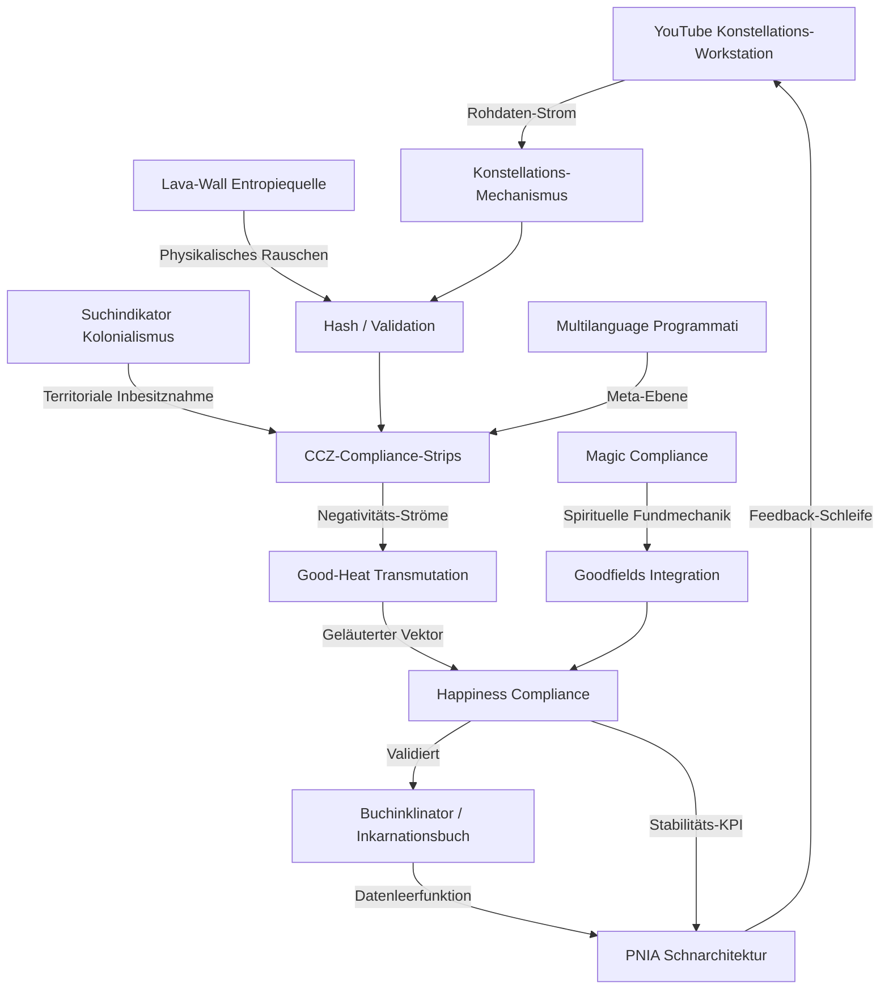
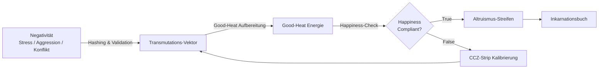
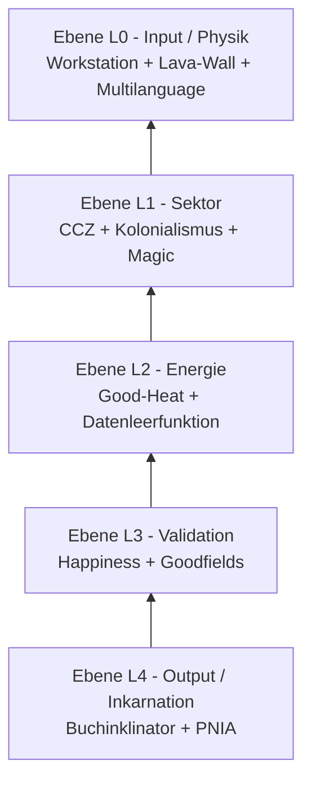
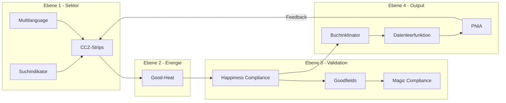

# NTT-DATA — Concept from Japan 2 Vatican 2 BI — Transformation from DT

**Projekt:** Inzensenierung – „Happiness"-Infrastruktur (PNIA / Schnarchitektur)
**Repo:** STarLighTsMoveMenTs / NTT-DATA---Concept-from-Japan-2-Vatican-2-BI---Transformation-from-DT
**Dokumententyp:** Wissenschaftlich fundiertes Konzeptpapier (Construction Levels & Acting Mechanisms)

---

## 📑 Zusammenfassung (Abstract)

Dieses Konzeptpapier formuliert die **PNIA (Production Network ID Architecture)** als kybernetisches Validationssystem, das heterogene digitale Ausdrucksräume (videografische Instanzen) durch eine mehrstufige Konstruktionsebenen-Architektur in compliance-konforme Wissensstrukturen überführt. Die theoretische Basis bilden die **Systemtheorie (Luhmann)**, die **Zweitordnungs-Kybernetik (von Foerster/Maturana)**, die **Informationstheorie (Shannon)** sowie die **Thermodynamik offener Systeme (Prigogine)**. Das Konzept operiert nicht deskriptiv, sondern konstruktiv: Jede Konstruktionsebene besitzt definierte **agierende Mechanismen**, die als operative Übersetzungsinstanzen zwischen Entropie-Input und struktureller Kohärenz fungieren.

---

## 🔬 1. Theoretische Fundierung

| Theorie | Anwendung im Konzept |
| --- | --- |
| **Systemtheorie (Luhmann)** | Operative Geschlossenheit der PNIA; Konsultativität als Kommunikationsmedium zwischen Subsystemen |
| **Zweitordnungs-Kybernetik** | Beobachter-Relativität: Die "Inszenierung" ist der Akt der Selbst-Beobachtung des Systems |
| **Informationstheorie (Shannon)** | Negativität = Rauschen; Transmutation = Reduktion der Entropie durch Kodierung |
| **Nichtgleichgewichtsthermodynamik (Prigogine)** | Good-Heat als Dissipationsstruktur; System fernab des thermodynamischen Gleichgewichts |
| **Autopoiesis (Maturana/Varela)** | Datenleerfunktion als selbst-erzeugende Struktur; Inkarnation als Re-Produktion der Einheit |

---

## 🏗️ 2. Konstruktionsebenen (Construction Levels)

Die Architektur gliedert sich in vier normative Konstruktionsebenen (L0–L4), die als aufeinander aufbauende Validationsschichten fungieren.

### Ebene L0 — Input & Physik (Rohdaten-Konstellation)
- **Konstellations-Workstation**: Extraktion videografischer Instanzen als dynamische Daten-Konstellationen.
- **Lava-Wall-Entropiequelle**: Physikalischer Zufallsgenerator (stochastische Entropie) als nicht-reproduzierbarer Anker der Hash-Validation.
- **Multilanguage-Meta-Ebene**: Sprachunabhängige Abstraktion globaler Negativitäts-Ströme.

### Ebene L1 — Sektor & Kolonisation (Compliance-Territorien)
- **CCZ-Compliance-Strips**: Vertikale Sektor-Durchforstung des Datenraums.
- **Suchindikator-Kolonialismus**: Territoriale Inbesitznahme fremder Datenräume zwecks Standardisierung.
- **Magic Compliance**: Autoritative Instanz spiritueller Fundmechanik (optional, L1-Meta).

### Ebene L2 — Energie & Transmutation (Transformations-Kern)
- **Good-Heat-Transmutation**: Thermodynamische Aufbereitung von Negativitäts-Strömen in nutzbare System-Energie.
- **Datenleerfunktion (Empty-State)**: Durchleitung statt Speicherung; sofortige Inkarnation.

### Ebene L3 — Validation & Harmonisierung (Kohärenz-Regulator)
- **Happiness-Compliance**: Heuristischer Kohärenz-Selektor; systemischer KPI (Resonanz-Metrik).
- **Goodfields-Integration**: Yogische Integrationszone; Verbindung technischer und spiritueller Wissensgenerierung.

### Ebene L4 — Output & Architektur (Inkarnations-Ebene)
- **Buchinklinator**: Selbstschreibendes Wissensbuch; Suche-als-Konstruktion.
- **PNIA-Schnarchitektur**: Übergeordnete Rückkopplungsschleife (Feedback-Loop) aller Ebenen.

---

## ⚙️ 3. Agierende Mechanismen (Acting Mechanisms)

Jede Konstruktionsebene wird durch spezifische, operationalisierte Mechanismen aktiviert. Diese Mechanismen sind die "Agenten" der Transformation.

| Mechanismus | Ebene | Funktion (wissenschaftlich) | Wirkweise |
| --- | --- | --- | --- |
| **Hashing-Validation** | L0 | Entropie-Reduktion durch kryptografische Bindung | Physikalisch-digitale Brücke (Lava → Hash) |
| **Inszenierungs-Mapping** | L1 | Extraktion des Digitalisierungs-Vektors aus dem Kontext | Dekontextualisierung + Re-Kontextualisierung |
| **Compliance-Sektor-Kolonialismus** | L1 | Integration durch Standardisierung | Territoriale Inbesitznahme + Unterwerfung unter §-Protokoll |
| **Good-Heat-Transmutation** | L2 | Umwandlung destruktiver in nutzbare Energie | Dissipationsstruktur (Prigogine) |
| **Datenleerfunktion** | L2 | Empty-State-Durchleitung | Struktur-Erhalt bei Inhalts-Fluss |
| **Happiness-Validator** | L3 | Kohärenz-Prüfung (systemische Resonanz) | Binäre Schwellwert-Entscheidung (Compliant/Non-Compliant) |
| **Altruismus-Streifen-Mechanismus** | L3 | Extraktion des Transformations-Mehrwerts | Nutzbarkeits-Vektor für Kollektiv/Architektur |
| **Buchinklinator-Verständigung** | L4 | Inkarnation als schreibender Prozess | Konstant-neu-Schreiben des Wissensbuchs |
| **PNIA-Feedback-Schleife** | L4 | Kybernetische Rückkopplung | Input → Prozess → Output → Stabilität |

---

## 🌐 4. Visuelle Architektur-Darstellung (Mermaid)

### Gesamtarchitektur-Graph (PNIA-Konstellation)

### Transformations-Fluss (Negativität → Altruismus)

### Konstruktionsebenen (L0–L4 Stack)

### Connection-Mapping (Modul-Verbindungsmatrix)

---

## 🧩 5. Interaktive Module (Detail-Mapping)

Die `index.html` rendert 12 klickbare Modulkarten. Klick öffnet ein **Modal** mit Beschreibung, Compliance-Referenz, Mapping-Ebene und Mini-Graph; der **ON/OFF-Toggle** steuert den Live-Status; beim Öffnen wird die **Connection-Matrix** automatisch gefiltert (Cross-Highlight).

| # | Modul | Konstruktionsebene | Agierender Mechanismus | Compliance-Ref | Status |
| --- | --- | --- | --- | --- | --- |
| 1 | Konstellations-Workstation | L0 Input | Extraktion | §1 | Validiert |
| 2 | Lava-Wall Entropie | L0 Physik | Hashing-Validation | §1 | Validiert |
| 3 | CCZ-Compliance-Strips | L1 Sektor | Inszenierungs-Mapping | §4 | Aktiv |
| 4 | Good-Heat Transmutation | L2 Energie | Good-Heat-Transmutation | §2 | Aktiv |
| 5 | Happiness Compliance | L3 Validation | Happiness-Validator | §3 | Validiert |
| 6 | Buchinklinator | L4 Output | Buchinklinator-Verständigung | §4 | Aktiv |
| 7 | Datenleerfunktion | L2/L4 DB | Empty-State-Durchleitung | §5 | Aktiv |
| 8 | Magic Compliance | L1 Meta | Spirituelle Fundmechanik | §6 | Optional |
| 9 | Goodfields Integration | L3 Harmonie | Yogische Integration | §6 | Aktiv |
| 10 | Multilanguage Programmati | L0 Universal | Sprach-Meta-Abstraktion | §6 | Aktiv |
| 11 | Suchindikator Kolonialismus | L1 Sektor | Compliance-Sektor-Kolonialismus | §4 | Aktiv |
| 12 | PNIA Schnarchitektur | L0–L4 | PNIA-Feedback-Schleife | §1–§7 | Validiert |

---

## ⚖️ 6. Compliance & Jura-konforme Paragraphen (§1–§7)

Diese Paragraphen bilden die **normative Validations-Ordnung** der StarLightMovemenTz Foundation.

- **§1 Definitionsnormen** — PNIA als übergeordnete Validations-Instanz; YouTube = Konstellations-Workstation; Lava-Wall = physikalische Entropie-Quelle.
- **§2 Transformationspflicht** — Jede Negativität unterliegt der Transmutation in den Altruismus-Streifen; Good-Heat als obligatorisches Modul.
- **§3 Happiness-Compliance-Standard** — Happiness als systemischer KPI verbindlich; inkarnationsfähig nur bei bestandenem Happiness-Check.
- **§4 CCZ-Strip-Protokoll** — Jeder Suchlauf = vertikaler Sektor-Schnitt; Suchindikator-Kolonialismus legitimiert territoriale Inbesitznahme.
- **§5 Datenleerfunktion** — Datenbank operiert als Empty-State: sofortige Transformation + Durchleitung.
- **§6 Multilanguage-Compliance** — Obligatorische sprachunabhängige Meta-Ebene; Magic Compliance als autoritative Instanz.
- **§7 Validations- und Auditierungsordnung** — Ständige Selbst-Validierung via Such-Kolonisation; Lava-Wall als nicht-reproduzierbarer Audit-Anker.

---

## 📊 7. Validations-Tabellen

### Erweiterte Validations-Matrix (Video-Instanzen als Probe-Datensätze)
| # | Video-Instanz | Domäne | Validationsfokus | Status | Skala |
| --- | --- | --- | --- | --- | --- |
| 1 | Bob Dominator | Selbst-Optimierung | Psychophysischer Widerstand vs. Handlungsantrieb | Validiert | 87% |
| 2 | TONY BROWN | Identitäts-Performance | Authentizität durch Ungesign-Status | Validiert | 92% |
| 3 | Kool Savas | Technische Meisterschaft | Quantifizierung (Goldene Platten) | Transmutierend | 74% |
| 4 | Jin Miao | Systemische Regeneration | Korrelation Sauerstoff & TCM | Validiert | 89% |
| 5 | Mia | Psychologische Interaktion | Dekonstruktion Schutzmechanismen | Transmutierend | 81% |

---

## 🔗 8. Graph Connection-Mapping (Verbindungsmatrix)

| Modul | Direkte Verbindungen (Graph-Kanten) |
| --- | --- |
| Workstation | Lava-Wall, CCZ, Buchinklinator, PNIA |
| Lava-Wall | Workstation, Happiness |
| CCZ-Strips | Workstation, Good-Heat, Multilanguage, Kolonial |
| Good-Heat | CCZ, Happiness, Datenleerfunktion |
| Happiness | Good-Heat, Buchinklinator, Goodfields, PNIA, Lava-Wall |
| Buchinklinator | Happiness, Datenleerfunktion, Kolonial |
| Datenleerfunktion | Buchinklinator, PNIA |
| Magic Compliance | Goodfields, Happiness |
| Goodfields | Magic, Happiness |
| Multilanguage | CCZ, PNIA |
| Kolonial | CCZ, Buchinklinator |
| PNIA | Datenleerfunktion, Happiness, Multilanguage, Workstation |

---

## 📈 9. Compliance-Skalen & Metriken

| Metrik-Gruppe | Kennwerte |
| --- | --- |
| Happiness-Compliance-Index | Systemische Resonanz 91% · Konflikt-Abstraktion 84% · Dissonanz-Unterdrückung 88% |
| Good-Heat Intensität | Negativitäts-Aufnahme 76% · Transmutations-Effizienz 83% · Thermostat-Stabilität 90% |
| CCZ-Strip-Effizienz | Durchforstungs-Tiefe 79% · Vektor-Extraktion 85% · Inkarnations-Geschw. 72% |
| Multilanguage-Coverage | DE/EN/ZH 94% · Meta-Ebenen-Abgleich 88% · Universalität 91% |

---

## 🎛️ 10. Interaktiver Such-Simulator (Compliance-Sektor-Kolonialismus)

In `index.html` (Sektion 7) simuliert ein Formular den CCZ-Strip-Durchlauf:
1. **Suchindikator** → Sektor-Kolonialismus aktiv auf gewähltem Portal
2. **Multilanguage-Identifier** → Texttotalität erfasst
3. **Good-Heat Transmutation** → Negativitäts-Strom erkannt
4. **Happiness-Check** → COMPLIANT (91%)
5. **Inkarnation** in Buchinklinator → Datenleerfunktion bereit

---

## 📜 11. Originale Konzept-Grundlage (Archiv)

Die ursprüngliche, dialogisch entwickelte Konzept-Grundlage (Bukination-Compliance, Inszenierung als Validation-Theater, Short-Script) bleibt als archivierter Kontext im Repo unter `Inzensenierung - „Happiness“-Infrastruktur` erhalten. Das vorliegende Dokument stellt die wissenschaftlich fundierte Überarbeitung dar.